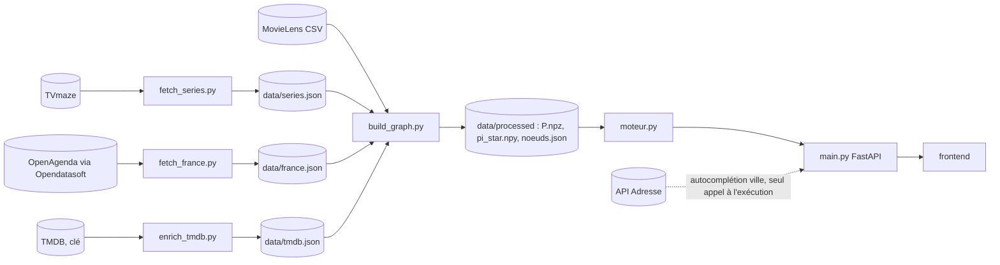

# Architecture technique

## Vue d'ensemble

## Composants
| Fichier | Rôle |
|---|---|
| `backend/fetch_france.py` | Événements **à venir** autour de 40 villes universitaires (rayon 15 km, 35 jours). Occurrences réelles `[début, fin]`, `date_debut` / `date_fin` en `YYYY-MM-DD` (Paris). Catégorisation, genres et tarif à partir des mots-clés du texte. |
| `backend/fetch_series.py` | 220 séries populaires (TVmaze) avec leurs identifiants IMDb et TVDB, pour TMDB. Aucune plateforme déduite. |
| `backend/enrich_tmdb.py` | Films (`/movie/{id}`) et séries (`/find` puis `/tv/{id}`) avec `append_to_response=watch/providers`. Lit **uniquement** `results.FR.flatrate`. Récupère aussi l'affiche, le titre FR et le résumé. Clé lue dans `TMDB_API_KEY` ou dans `.env`. |
| `backend/build_graph.py` | P (films + séries + sorties), π\*, `noeuds.json`. `plateformes_verifiees` vaut `true` seulement pour les titres présents dans `tmdb.json`. |
| `backend/moteur.py` | Vecteur de départ, marches, affinité, quota, masques (plateformes vérifiées, Haversine, fenêtres temporelles). |
| `backend/main.py` | Routes, proxy API Adresse, couverture la plus proche, service du frontend. |

## Sorties (`france.json`)
- Requête OpenAgenda par ville : `within_distance(location_coordinates, POINT(lon lat), 15km)`, `lastdate_end >= now()`, `firstdate_begin <= now(days=35)`.
- On ne garde un événement que s'il a **au moins une occurrence non terminée** dans l'horizon. Exclus : annulés, emploi, petite enfance, culte, `age_max ≤ 14`.
- Sélection par ville : quota (120 pour Paris, 30 à 80 ailleurs), réparti à tour de rôle entre les 5 catégories (photo et date proche d'abord).
- Au total : **1 123 événements, dont 1 116 avec photo**. Il faut relancer `fetch_france.py` régulièrement, car les événements vieillissent.

## Filtres à l'exécution (`Moteur.autorises`)
- **Plateformes** (films, séries) : présence confirmée par TMDB sur au moins un abonnement de l'utilisateur. Sans aucune donnée TMDB, le filtre est **désactivé** et l'interface l'annonce.
  Ce n'est pas une supposition : sans données, on ne peut ni inclure ni exclure.
- **Distance** (sorties) : Haversine vectorisée `≤ rayon_km` autour de la ville choisie. La distance arrondie est renvoyée sur chaque carte.
- **Temps** (sorties) : au moins une occurrence intersecte la fenêtre de l'horizon, avec `fin ≥ maintenant`.
  - `court` : reste d'aujourd'hui + samedi 0h → lundi 0h (le week-end en cours si l'on est samedi ou dimanche)
  - `semaine` : maintenant → +7 jours ; `mois` : maintenant → +30 jours
- `prochaine_occurrence` : la première occurrence non terminée **dans la fenêtre**, avec ses vraies heures de début et de fin, ce qui permet d'afficher « En cours ».

## Graphe et moteur
- Films : co-occurrences MovieLens, élagage hybride (25 voisins par comptage + 25 par cosinus).
- Séries et sorties : reliées aux 30 films les plus proches selon `cos(genres) · log(1 + likes)`. Chaque film consacre au plus 15 % de sa ligne aux nœuds externes.
- 8 706 nœuds, environ 350 k arêtes.
- `v_u` : 25 films de référence par genre favori, plus les « Déjà vu » (60 % de la masse).
- Deux marches (Confort α = 0.10, Découverte α = 0.50 avec un restart biaisé π\*^-2 limité aux films du voisinage).
  Nombre d'itérations adaptatif, tel que (1-α)^n ≤ 4 %. Calcul en float32, comme P.
- Score × affinité de genres ; lift (÷ π\*) pour les séries et sorties ; curseur par quota ; dédoublonnage des titres.
- Type `tout` : les marches sont calculées une fois et partagées entre le classement des films et celui des séries (2 films pour 1 série).

## Décisions techniques
- **Pas de lieux permanents (OSM)** : la consigne impose des sorties datées. Un musée sans date ne rentre pas dans les horizons temporels.
- **Occurrences stockées avec leurs vraies heures** : une première version remplaçait le début d'une occurrence en cours par « maintenant ». On affichait alors « Ce soir · 20h28 » pour un concert commencé à 20h.
- **float32 + itérations adaptatives** : la latence était passée à 38 ms avec 1 123 sorties. Le mélange float32/float64 forçait une conversion à chaque produit.
- **Gratuit retiré des plateformes** : ce n'est pas un abonnement `flatrate`. Le tarif « Gratuit » des sorties reste affiché.

## Limites connues
- **Sans clé TMDB** : affiches typographiques pour les films, affiches TVmaze pour les séries, « Disponibilité non vérifiée » partout.
- **Couverture des sorties** : 40 villes. Ailleurs, l'application propose la ville couverte la plus proche (ex. Bourges → Orléans, 95 km).
- **Plafond de collecte** : 300 événements bruts par ville (Paris en a davantage). Le rayon de 50 km ne voit que ce qui a été collecté à 15 km des villes.
- **Compteurs « Intéressé »** : en mémoire, avec une valeur de départ simulée.
