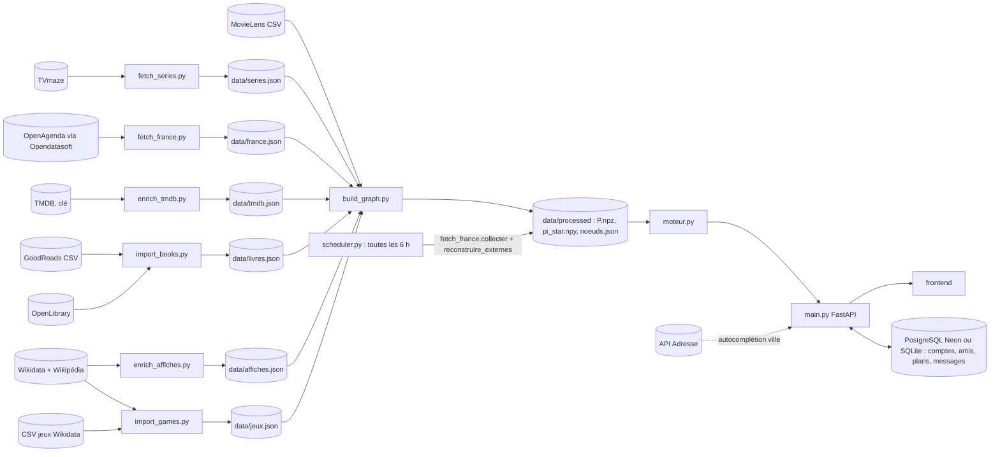

# Architecture technique

## Vue d'ensemble


## Composants
| Fichier | Rôle |
|---|---|
| `backend/fetch_france.py` | Événements **à venir** autour de 40 villes universitaires (rayon 15 km, 35 jours). Occurrences réelles `[début, fin]`, `date_debut` / `date_fin` en `YYYY-MM-DD` (Paris). Catégorisation, genres et tarif à partir des mots-clés du texte. |
| `backend/fetch_series.py` | 220 séries populaires (TVmaze) avec leurs identifiants IMDb et TVDB, pour TMDB. Aucune plateforme déduite. |
| `backend/enrich_tmdb.py` | Films (`/movie/{id}`) et séries (`/find` puis `/tv/{id}`) avec `append_to_response=watch/providers`. Lit **uniquement** `results.FR.flatrate`. Récupère aussi l'affiche, le titre FR et le résumé. Clé lue dans `TMDB_API_KEY` ou dans `.env`. |
| `backend/import_books.py` | 2 500 livres les plus lus (note ≥ 3,7, une édition par titre) du CSV GoodReads. Genres traduits. Édition française cherchée sur OpenLibrary (titre FR + couverture), sinon couverture GoodReads. |
| `backend/enrich_affiches.py` | Affiches de films sans clé : IMDb (MovieLens) → Wikidata (titre FR, article) → image principale Wikipédia (`pilicense=any`, ~250 px). |
| `backend/build_graph.py` | P (films + séries + sorties), π\*, `noeuds.json`. `plateformes_verifiees` vaut `true` seulement pour les titres présents dans `tmdb.json`. |
| `backend/moteur.py` | Vecteur de départ, marches, affinité, quota, masques (plateformes vérifiées, Haversine, fenêtres temporelles). |
| `backend/main.py` | Routes, proxy API Adresse, couverture, comptes, plans, agenda, service du frontend. Le moteur courant est dans `Catalogue.moteur` (remplacé d'un bloc après une synchro). |
| `backend/database.py` | PostgreSQL (`DATABASE_URL`, psycopg 3 + pool) ou SQLite (stdlib), mêmes requêtes : `utilisateurs` (+ `code`, `dispo`, `dispo_le`, `demo`, ajoutées par migration douce), `amities` (symétrique), `plans`, `participants`, `messages`, `meta`. Une connexion par opération, WAL. Profils de démo insérés à l'initialisation. |
| `backend/scheduler.py` | `Synchroniseur` : boucle asyncio (6 h) + déclenchement manuel. Collecte OpenAgenda dans un thread, retire le passé, reconstruit le graphe, recharge le moteur. |

## Sorties (`france.json`)
- Requête OpenAgenda par ville : `within_distance(location_coordinates, POINT(lon lat), 15km)`, `lastdate_end >= now()`, `firstdate_begin <= now(days=35)`.
- On ne garde un événement que s'il a **au moins une occurrence non terminée** dans l'horizon. Exclus : annulés, emploi, petite enfance, culte, `age_max ≤ 14`.
- Sélection par ville : quota (120 pour Paris, 30 à 80 ailleurs), réparti à tour de rôle entre les 11 catégories (cinéma, expo, scène, nature, rencontres, jeux vidéo, cuisine, créatif, lecture, café, sport) (photo et date proche d'abord).
- Au total : **1 120 événements, dont 1 113 avec photo** (27/11/2026). Il faut relancer `fetch_france.py` régulièrement, car les événements vieillissent.

## Filtres à l'exécution (`Moteur.autorises`)
- **Plateformes** (films, séries) : présence confirmée par TMDB sur au moins un abonnement de l'utilisateur. Sans aucune donnée TMDB, le filtre est **désactivé** et l'interface l'annonce.
  Ce n'est pas une supposition : sans données, on ne peut ni inclure ni exclure.
- **Distance** (sorties) : Haversine vectorisée `≤ rayon_km` autour de la ville choisie. La distance arrondie est renvoyée sur chaque carte.
- **Temps** (sorties) : au moins une occurrence intersecte la fenêtre de l'horizon, avec `fin ≥ maintenant`.
  - `maintenant` : maintenant → +3 h ; `aujourdhui` : maintenant → minuit
  - `weekend` : samedi 0h → lundi 0h (le week-end en cours si l'on est samedi ou dimanche) ; `court` = aujourdhui + weekend (anciens profils)
  - `semaine` : maintenant → +7 jours ; `mois` : maintenant → +30 jours
- **Ambiances** (sorties) : étiquettes `festif`, `calme`, `drole`, `insolite`, `competitif`, `artistique` repérées par mots-clés dans `fetch_france.py`.
  Colonnes de la matrice des genres (affinité) + bonus ×(1 + `BONUS_AMBIANCE`) ; exclues du malus de découverte (humeur, pas bulle).
- **Genre « Historique »** : MovieLens n'a pas de genre Histoire, il est relié à `War`.
- `prochaine_occurrence` : la première occurrence non terminée **dans la fenêtre**, avec ses vraies heures de début et de fin, ce qui permet d'afficher « En cours ».

## Affiches : sources et garanties
| Type | Source | Couverture |
|---|---|---|
| Films | TMDB w342 (clé) > Wikipédia (~250 px) | 1,3 % sans clé : **Wikimedia limite les scripts sans contact (429)**. iTunes Search renvoie 0 résultat pour les films (vérifié). |
| Séries | TMDB > TVmaze (~680 px) | 100 % |
| Livres | Édition FR OpenLibrary (L) > GoodReads | 100 % |
| Sorties | Photo OpenAgenda, sinon visuel sobre avec icône | 99 % |

Règle dans `Moteur` : si un type a au moins 90 % d'affiches, les œuvres sans affiche sont **exclues**. Sinon, leur score est ×0,3 (mise en avant des œuvres illustrées).
Avec une clé TMDB, ou une fois `enrich_affiches.py` terminé, les films passeront automatiquement en mode strict.

## Livres
- 2 500 nœuds `livre`, reliés comme les séries (15 films les plus proches par genres). Lift en confort, comme pour les autres nœuds externes.
- Genres GoodReads → genres de l'application (ex. « Science Fiction », « Dystopia » → SF ; « Nonfiction », « Biography » → Documentaire).
- Budget : un livre n'a pas de prix connu, il est donc exclu dès qu'un budget est demandé.
- Pas de traduction automatique : sans édition française trouvée, le titre reste en VO et aucun résumé n'est affiché.

## Catégories et univers
- Envies (accueil, profil) : `ecrans`, `lecture`, `jeux` (univers Chez soi) ; `culture`, `soirees`, `nature` (univers Sorties).
- `GROUPES_SORTIES` (main.py) : culture = cinéma + expo + scène + rencontres littéraires (+ `culture` pour les sorties publiées) ;
  soirées ; nature. Sans filtre, seules ces catégories sont autorisées : les catégories hors sujet sont exclues des recommandations.

## Thèmes de lecture
- 6 thèmes (Roman & Fiction, Thriller & Polar, Science-Fiction & Fantasy, Développement & Essais, BD & Manga, Biographie & Histoire),
  calculés depuis les genres GoodReads d'origine (`import_books.py --themes-seulement`, sans réseau). « Roman » seulement à défaut
  d'un thème plus précis (« fiction » est partout).
- Moteur : les thèmes choisis jouent pour les livres le rôle des genres. Confort = affinité × (0,15 + part de thèmes choisis) ;
  découverte = malus progressif (jusqu'à -90 %) sur ces thèmes → autres thèmes, étiquette « Hors piste ».

## Jeux vidéo
- Filtre : `Type == "video game"`, sortie en 2015 ou après, fiche complète (plateformes, genres, studio, éditeur, URL) ;
  16 jeux à contenu adulte (eroge, bishōjo) exclus, soit **3 279 jeux**.
- Consoles regroupées : PC (Windows et Linux), Mac, PlayStation, Xbox, Nintendo Switch, Mobile (iOS et Android).
  Les consoles anciennes (3DS, Wii U…) sont ignorées.
- Genres : 309 genres anglais, traduits par environ 60 règles ordonnées vers une quarantaine de libellés français (RPG, Action-RPG,
  Tir à la première personne, Stratégie au tour par tour, Réflexion, Roman visuel…). Un genre non couvert est **ignoré**
  (119 jeux n'ont aucun genre affiché). Les termes d'usage dans la presse française sont conservés (RPG, Metroidvania, Roguelike, Battle royale).
- Modes : badge « Solo » ou « Multijoueur » (co-op et multijoueur en ligne regroupés) ; filtre `mode_jeu`
  (tous, solo, multi ; `coop` accepté comme alias de `multi`) et filtre par machine dans l'onglet Jeux vidéo.
- Données françaises, par lots : Wikidata `wbgetentities` (libellé FR, articles), extrait d'introduction de fr.wikipedia
  (2 phrases), jaquette = image principale de l'article anglais (`pilicense=any`).
- Graphe : chaque genre français est aussi associé à des genres de l'application (ex. RPG → Fantasy + Adventure) pour relier les jeux aux films.
- Budget : prix inconnu, donc exclus dès qu'un budget est demandé (comme les livres).

## Soirées & Concerts
- Catégorie `soirees` (concert, soirée, DJ, club, électro, festival, live, fête, karaoké, afterwork, open mic, blind test, jazz, rock, rap…).
  « Spectacles & Scène » regroupe désormais théâtre, danse, cirque et humour.
- Collecte : pour chaque ville, en plus de la requête générale, une requête OpenAgenda dédiée (`search(title_fr | keywords_fr, …)`), avec un quota de 25 soirées.
- Villes des utilisateurs hors couverture (> 20 km d'une ville connue) : collecte ciblée dès l'inscription, puis à chaque synchro.
- Sorties publiées par les utilisateurs (SQLite `sorties_communaute`) : intégrées au graphe (genres déduits du titre et de la catégorie), reconstruction à chaud en ~1 s.

## Découverte : niche et dépaysement
```
confort    = π_confort × aff                      aff = 0.15 + cos(genres, profil)
découverte = π_découverte / π* × q × (1 − 0.9 · s · m)
```
- `π_découverte / π*` : lift, ce qui est sur-représenté autour de l'utilisateur (**niche**).
- `m` = part des genres de l'œuvre qui sont des genres **cochés** (à défaut : genres des « Déjà vu »).
  `s` = position du curseur : à 10/10, une œuvre 100 % dans les genres cochés perd 90 % (**dépaysement**).
- `q` : plancher de qualité (films aimés par au moins 5 personnes) ; la marche garantit la cohérence avec les goûts.
- L'affinité ne s'applique **pas** à la découverte (elle annulerait le dépaysement).
- Étiquette : `pepite` si `m ≥ 0.5` (niche dans ses genres), sinon `hors-piste`.
- Mesuré (SF + Thriller) : à 0/10 Matrix et Star Wars ; à 10/10 Quest for Fire, Shadowlands, Forget Paris, tous « hors piste ».

## Budget (coût marginal)
- `prix_num` (euros) : tarif publié, sinon déduit de la description (« gratuit », « entrée libre », « 0 € », « 5 € », « 8,50 € »),
  sinon `null`. 759 sorties sur 1 300 ont un prix connu, dont 449 gratuites.
- Sorties : « Gratuit » = `prix_num == 0` strictement ; « < 10 € » / « < 25 € » = `prix_num ≤ plafond` **ou tarif non précisé**
  (gardé, affiché « Tarif non précisé »).
- Films et séries : inclus dans les abonnements = 0 €. Avec des plateformes vérifiées (TMDB), seuls ceux présents sur un
  abonnement de l'utilisateur ou sur Arte ; sans données TMDB, tous restent visibles.
- Livres et jeux : considérés comme déjà possédés ou empruntables, jamais exclus par le budget.

## Temps disponible
`duree_categorie` attribuée au build (`build_graph.duree_categorie`) : `express` (< 45 min), `soiree` (1 h 30 – 2 h 30), `long`.
- Films : soirée. Séries : express si comédie ou animation hors drame (épisodes de ~22 min), sinon soirée.
- Livres : express si BD ou 200 pages au plus, sinon long. Jeux : long (RPG, stratégie, simulation, monde ouvert…), express
  (casual, réflexion, arcade, rythme, course…), sinon soirée.
- Sorties : long (nature, festivals), express (rencontres, dédicaces), sinon soirée ; en express, une sortie à moins de 5 km compte aussi.

## « Choisir à ma place »
Tirage uniforme côté client dans **tout le pool affiché** pour l'onglet et les filtres actifs (Pour vous : écrans + sorties ;
autres onglets : la grille, 20 à 40 résultats), sans retomber deux fois de suite sur le même élément. Micro-effet de ~500 ms
(visuels qui défilent en ralentissant), puis fiche ouverte avec le badge « Sélectionné pour vous ».
Mesuré : 40 tirages sur un pool de 20 -> 18 éléments distincts, 0 répétition consécutive.

## Comptes, mots de passe et session
- Inscription (« Créer un compte ») : prénom ou pseudo, avatar, mot de passe (6 caractères minimum), ville et périmètre, goûts.
  Connexion (« Se connecter ») : prénom ou code « Prénom#123 » + mot de passe ; homonymes départagés par le mot de passe.
- Mot de passe : empreinte PBKDF2-SHA256 salée, 240 000 itérations (`pbkdf2_sha256$itérations$sel$empreinte`, colonne
  `mdp_hash`), comparée en temps constant ; jamais en clair, jamais renvoyée, jamais stockée côté client.
  Anti-essais : 5 échecs en 15 min par identifiant, 20 par adresse IP -> 429 (compteurs en mémoire du processus).
- Session : jeton aléatoire (32 octets) dans `localStorage` (`actif`), état par compte, liste `comptes` `{id, prenom, code}`
  pour repasser d'un compte à l'autre sur le même appareil. « Se déconnecter » oublie le jeton de l'appareil.
- Démarrage : seul un **401** fait oublier le jeton (compte absent de la base) et ouvre « Se connecter ». Une panne passagère
  (redémarrage après mise à jour, réveil de Render ou de Neon, réseau) garde la session : c'était la cause des profils
  vierges recréés. Plus de liste ouverte des profils ni de reprise par simple code.
- Les profils de démo n'ont pas de mot de passe : on ne peut pas s'y connecter.

## Amis et statut « Dispo »
- Code public `Prénom#NNN` unique (insensible à la casse), attribué à la création (et aux comptes existants à l'initialisation).
  C'est le seul identifiant montré aux autres : le jeton `id` sert de connexion et ne sort jamais.
- Amitié sans demande à accepter (outil de démo) : deux lignes `amities` (a → b, b → a), retrait des deux sens.
- Humeur `indispo` (Mode ermite) | `sortir` (Partant pour bouger) | `distance` (Chill à distance) + date ; considérée `indispo`
  12 h après le choix. Elle ordonne Pour vous (sorties d'abord, ou « Ce soir au chaud » d'abord). Amis rechargés toutes les 60 s.
- Avatars : colonne `avatar` (JSON DiceBear), rendu 100 % client avec les modules DiceBear 9.4.3 copiés dans `frontend/vendor/dicebear`
  (core, lorelei, micah ; imports réécrits en local) : pas d'API ni de CDN, rendu hors ligne et sans latence. Couleurs imposées
  (palettes désaturées) : le `seed` choisit dedans, de façon stable. Sans configuration : style Éditorial, `seed` = prénom, fond par
  hachage FNV-1a. Modules non chargés : initiales sur ardoise. Licences : core MIT, Lorelei CC0, Micah CC BY 4.0 (crédit dans le
  studio) — `vendor/dicebear/LICENCES.txt`.
- 4 profils de démonstration (`demo-*`) avec avatar et humeur active, proposés en suggestions et marqués « Démo ».

## Hors écran (activités)
- Catalogue éditorial `backend/data/activites.json` (versionné, chargé une fois au démarrage) : 35 activités (12 créatives,
  11 cuisine, 12 mouvement), chacune avec titre, défi concret, durée, matériel (`sans` / `basique` / `equipe`), modes
  (`solo`, `groupe`), icône Lucide, « Il te faut », étapes, et un score `insolite` (0 à 1). Pas d'image : visuel = teinte
  feutrée par catégorie + icône (jamais d'illustration inventée).
- `moteur.classer_activites` : score = (1 − s)·(1 − insolite) + s·insolite ± 0,06 (variation stable sur la journée).
  À 0/10 : crêpes, cookies, course à pied ; à 10/10 : linogravure, gyoza, escalade de bloc (« Hors piste »).
- Hors du graphe PageRank (pas de co-occurrences pour ces activités) ; plans, « Mes envies », tirage et synchro temps réel
  les traitent comme les autres contenus (`type: "activite"`).

## Temps réel (smart polling)
- `GET /api/sync` : amis (humeur, avatar), plans de l'entourage avec participants, humeur actuelle ; empreinte SHA-1
  du contenu (`v`) : réponse minimale si rien n'a changé. Participants et messages lus en une requête par lot.
- Client : toutes les 12 s si `document.visibilityState === "visible"`, immédiatement sur `visibilitychange`, `focus`
  et `pageshow`. Premier passage = mémorisation sans alerte ; ensuite nouveau plan d'un ami ou nouvel arrivant :
  toast, pastille « Nouveau » (carte de session, ligne « Avec … », fiche, point sur l'onglet Pour vous) jusqu'à
  l'ouverture de la fiche. Mises à jour ciblées (rangée des sessions avec position conservée, lignes des cartes,
  fiche ouverte avec défilement conservé), reportées si une saisie ou le menu d'humeur est actif.

## Billetterie des sorties (OpenAgenda)
- `fetch_france.billetterie()` : `complet` (statut OpenAgenda id 5), `libre` (conditions explicites : entrée libre,
  sans réservation…), `reservation` (lien / téléphone d'inscription publié, ou conditions qui le disent), sinon rien.
  Jamais déduit du prix. Lien `reservation_url` (https uniquement) et `reservation_tel`.
- Mesuré (28/11/2026) : 1 299 sorties, 810 sur réservation (718 avec lien), 118 entrée libre, 4 complet, 367 sans information.

## Espace collaboratif
- Plan = créneau (`debut`, heure de Paris) + point de rendez-vous ou lien + message, sur une œuvre.
  `format` : `physique` (en vrai) ou `en_ligne`, au choix pour les films, séries, livres et jeux (par défaut en ligne, en vrai
  pour les livres) ; toujours `physique` pour les sorties et les activités. Affiché « En vrai » / « En ligne » sur les plans. Le créateur est inscrit d'office.
- Le titre et le type de l'œuvre sont copiés dans le plan : il reste lisible si l'événement sort du catalogue.
- Plans visibles jusqu'à 6 h après leur début. Un plan sans plus aucun participant est supprimé.
- Chaque recommandation inclut `plans` (une requête SQL par lot) : « Ce soir · 22h00 · Avec Malo et toi ».
- Validation : créneau dans le futur (≤ 60 jours), rendez-vous ≤ 200 caractères, message ≤ 280. Un lien n'est cliquable que s'il commence par `https://`.

## Synchronisation de l'agenda
- Démarrage : tâche asyncio. Prochaine synchro = dernière + 6 h (date en SQLite `meta`, ou `genere_le` de `france.json`).
- Synchro : `collecter()` (~40 s), puis `retirer_passes()`, `ecrire()` (atomique), `reconstruire_externes()` (< 1 s, à partir de `S_films.npz`, sans MovieLens),
  puis `Catalogue.charger()`. Si le réseau échoue : nettoyage du passé et rechargement quand même ; le statut passe à « erreur ».
- Mesuré : 43 s au total, 0 coupure, 69 ms de latence au pire pendant la reconstruction. Bouton manuel limité à un clic toutes les 2 minutes.

## Graphe et moteur
- Films : co-occurrences MovieLens, élagage hybride (25 voisins par comptage + 25 par cosinus).
- Séries et sorties : reliées aux 30 films les plus proches selon `cos(genres) · log(1 + likes)`. Chaque film consacre au plus 15 % de sa ligne aux nœuds externes.
- 14 646 nœuds (7 363 films, 220 séries, 2 500 livres, 3 279 jeux, ~1 280 sorties), environ 364 k arêtes. Latence ~17 ms.
- Réglages de taille : 20 + 20 voisins par film (comptage + cosinus), 10 films par nœud externe, tolérance de la marche de 5 %.
  Mesuré : top 10 films stable (8 à 10 sur 10) par rapport aux réglages précédents.
- `v_u` : 25 films de référence par genre favori, plus les « Déjà vu » (60 % de la masse).
- Deux marches (Confort α = 0.10, Découverte α = 0.50 avec un restart biaisé π\*^-2 limité aux films du voisinage).
  Nombre d'itérations adaptatif, tel que (1-α)^n ≤ 4 %. Calcul en float32, comme P.
- Score × affinité de genres ; lift (÷ π\*) pour les séries et sorties ; curseur par quota ; dédoublonnage des titres.
- Type `tout` : les marches sont calculées une fois et partagées entre le classement des films et celui des séries (2 films pour 1 série).

## Décisions techniques
- **Pas de lieux permanents (OSM)** : la consigne impose des sorties datées. Un musée sans date ne rentre pas dans les horizons temporels.
- **Occurrences stockées avec leurs vraies heures** : une première version remplaçait le début d'une occurrence en cours par « maintenant ». On affichait alors « Ce soir · 20h28 » pour un concert commencé à 20h.
- **float32 + itérations adaptatives** : la latence était passée à 38 ms avec 1 123 sorties. Le mélange float32/float64 forçait une conversion à chaque produit.
- **Gratuit retiré des plateformes** : ce n'est pas un abonnement `flatrate`. Le tarif « Gratuit » des sorties reste affiché.

## Limites connues
- **Sans clé TMDB** : affiches typographiques pour les films, affiches TVmaze pour les séries, « Disponibilité non vérifiée » partout.
- **Couverture des sorties** : 40 villes. Ailleurs, l'application propose la ville couverte la plus proche (ex. Bourges → Orléans, 95 km).
- **Plafond de collecte** : 300 événements bruts par ville (Paris en a davantage). Le rayon de 50 km ne voit que ce qui a été collecté à 15 km des villes.
- **Session = jeton porteur** : quiconque obtient le jeton d'un appareil (accès au navigateur) agit au nom du compte ; pas de
  réinitialisation de mot de passe par e-mail (aucune adresse collectée). Suffisant pour la démo, à renforcer pour une production.
- **Découverte des séries et sorties à 10/10** : les résultats « hors piste » se ressemblent d'un profil à l'autre (petit catalogue).
